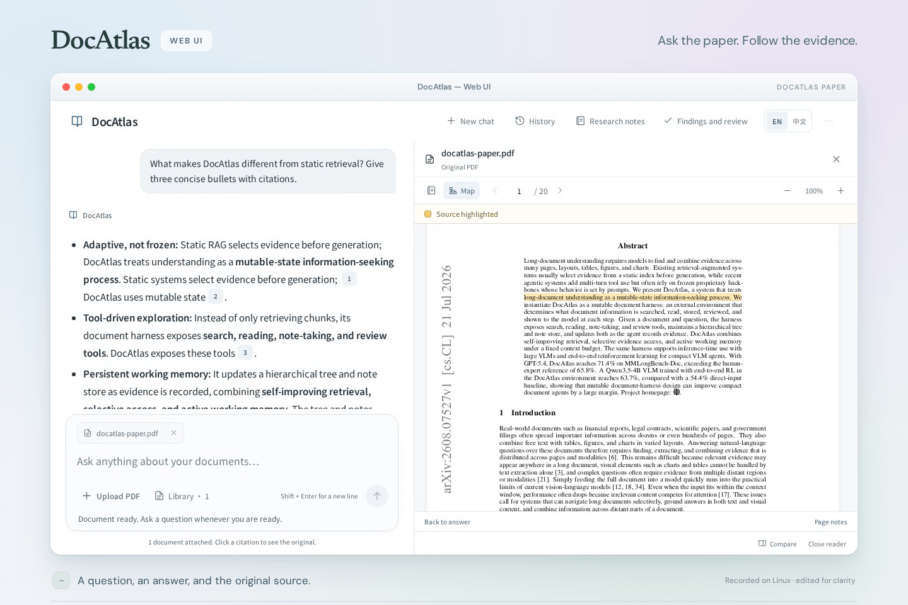
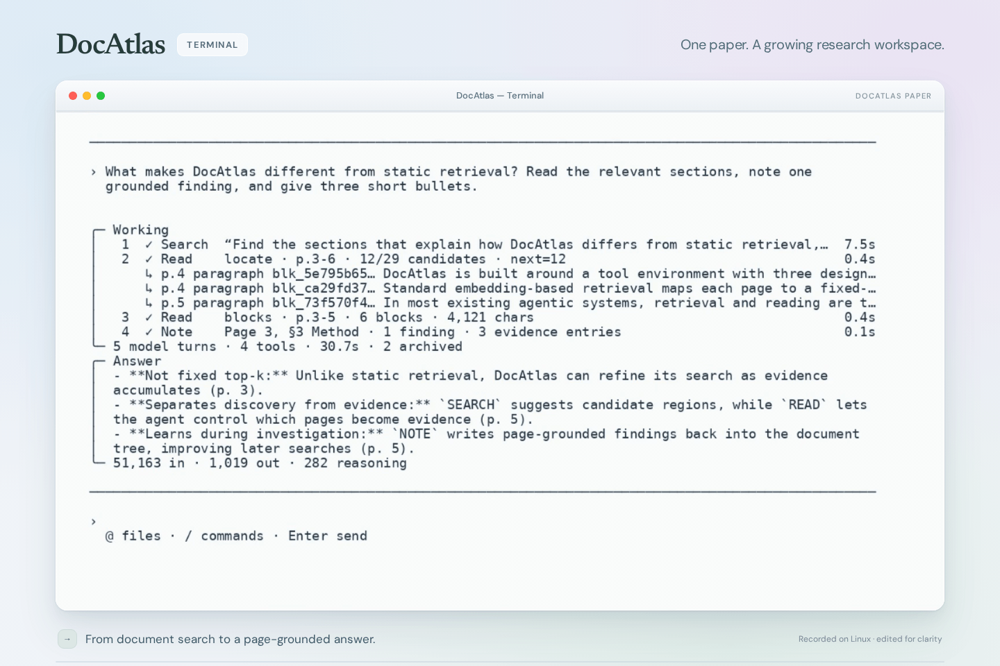
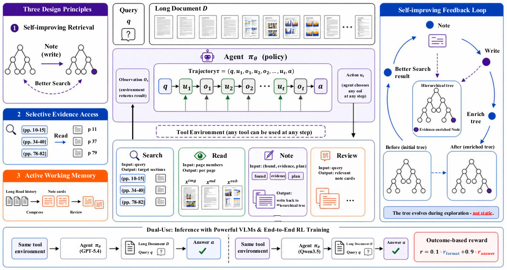

# DocAtlas：以可变状态交互理解长文档

<p align="center">
  <a href="README.md">English</a> · <strong>简体中文</strong>
</p>

<p align="center">
  <strong>面向长篇多模态文档、支持基于证据推理的开源智能体执行框架。</strong>
</p>

<p align="center">
  <a href="https://officeintelligence.github.io/docatlas/"></a>
  <a href="https://arxiv.org/abs/2608.07527"></a>
  
  <a href="https://github.com/microsoft/DocAtlas-Harness/actions/workflows/ci.yml"></a>
  <a href="https://github.com/microsoft/DocAtlas-Harness/actions/workflows/github-code-scanning/codeql"></a>
  <a href="https://opensource.org/license/mit"></a>
  
  <a href="https://agentskills.io/"></a>
  <a href="https://officeintelligence.github.io/xl-docbench/"></a>
</p>

<p align="center">
  <a href="https://officeintelligence.github.io/docatlas/"><b>项目主页</b></a>
  · <a href="https://officeintelligence.github.io/"><b>研究主页</b></a>
  · <a href="https://arxiv.org/abs/2608.07527"><b>论文</b></a>
  · <a href="#web-ui"><b>Web 界面</b></a>
  · <a href="#interactive-tui"><b>交互式终端</b></a>
  · <a href="#results-and-leaderboard"><b>排行榜</b></a>
  · <a href="https://officeintelligence.github.io/xl-docbench/"><b>XL-DocBench</b></a>
  · <a href="ARCHITECTURE.md"><b>架构说明</b></a>
</p>

> **最新消息 — NeurIPS 2026：** [DocAtlas](https://officeintelligence.github.io/docatlas/)
> 和 [XL-DocBench](https://officeintelligence.github.io/xl-docbench/) 均已被 **NeurIPS 2026** 接收。

DocAtlas 将 PDF 集合变成一个可持续更新的工作空间。智能体可以搜索文档树、读取选定的文本和图像、
记录带有页面依据的发现，并在后续步骤中重新调用这些发现。每一步获得的证据都会影响后续能够检索到的内容。

> **文档不再只是一个静态索引，而是智能体在工作过程中能够持续完善的状态。**

> **复现论文结果必须使用 MinerU 2.5。** 请使用它生成的逐页 Markdown 和提取图片来复现论文报告的结果。
> CLI 的 Docling 预处理和独立 Web UI 均不是论文复现路径。
> 详见[论文复现要求](#paper-reproduction-mineru-25-required)。

## Web UI

通过可选的本地浏览器应用与 PDF 对话、沿经过验证的引用查看原文页面，并保存研究笔记。
安装、模型访问、可选树搜索和使用方法见 [Web UI 指南（英文）](web/README.md)。
Web 使用独立的运行环境，目前是本地测试版，不承诺复现论文分数或 CLI 性能。

<p align="center">
  <a href="web/assets/web-ui.gif">
    
  </a>
</p>

<a id="interactive-tui"></a>

## ✨ 交互式 TUI

<p align="center">
  <a href="assets/tui-demo.gif">
    
  </a>
</p>

### 本地启动

安装 [uv](https://docs.astral.sh/uv/)，然后执行：

```bash
git clone https://github.com/microsoft/DocAtlas-Harness.git
cd DocAtlas-Harness
uv sync --locked
cp .env.example .env                 # fill in your Azure deployment
az login                              # omit when using AZURE_OPENAI_API_KEY
bash scripts/start_tui.sh
```

将 Azure 部署信息填写到 `.env`。也可以使用 API 密钥认证：在 `.env` 中设置
`AZURE_OPENAI_API_KEY`，此时无需执行 `az login`。
由于 Docling 会引入 Torch 和平台加速库，在 Linux 上首次同步环境可能占用约 5 GB 空间；
首次本地 Markdown 预处理会下载约 2 GB 的版面分析模型。

### 选择文档并开始提问

| 起始方式 | 示例 |
|---|---|
| 交互式选择器 | 运行 `bash scripts/start_tui.sh`，然后按 <kbd>@</kbd> |
| 单个 PDF | `bash scripts/start_tui.sh @report.pdf` |
| 多个 PDF | `bash scripts/start_tui.sh @report.pdf @appendix.pdf` |
| 文件夹 | `bash scripts/start_tui.sh @reports/ --recursive` |
| 远程 PDF | `bash scripts/start_tui.sh 'https://example.com/report.pdf'` |

工作台会在 `outputs/tui/` 下创建或复用按内容寻址的工作空间，并在后续追问中保持同一模型对话。
本地选择器支持单个文件、多选和整个文件夹；HTTP(S) PDF 会下载到经过校验的私有缓存中。

| 交互方式 | 功能 |
|---|---|
| <kbd>@</kbd> | 在输入区域打开 PDF 和文件夹选择器。 |
| <kbd>/</kbd> | 显示匹配的命令；继续输入可筛选，按 <kbd>Tab</kbd> 补全。 |
| <kbd>↑</kbd> / <kbd>↓</kbd> | 选择补全项或调出历史问题。 |
| <kbd>Esc</kbd> | 关闭弹窗、取消输入或中断当前轮次。 |
| 连按两次 <kbd>Ctrl</kbd>+<kbd>C</kbd> | 首次取消当前操作；在两秒内再次按下则正常退出。 |
| <kbd>Ctrl</kbd>+<kbd>L</kbd> | 清空可见屏幕，并在顶部重新显示当前输入草稿。 |

主对话保留在终端的普通缓冲区中，已完成的轮次仍可滚动查看和复制。
每个聊天会话从干净的可见页面开始，实时输出与终端底边保留间距，输入区下方保留两行空白。
颜色会自动适配终端；也可以将 `DOCATLAS_THEME` 设置为 `dark`、`light` 或 `auto`，
或设置 `NO_COLOR=1` 使用无彩色界面。

<details>
<summary><b>TUI 命令参考</b></summary>

| 命令 | 功能 |
|---|---|
| `/add <@path\|URL>` | 添加 PDF，并开始新的文档对话。 |
| `/new <@path\|URL>` | 替换当前文档集合。 |
| `/files` | 显示当前文档。 |
| `/overview [view]` | 打开 Summary、Findings、Outline 或 History 视图，不调用模型。 |
| `/overview export` | 在当前工作空间内写入私有的 `overview.md`。 |
| `/clear` | 清空对话历史，但保留预处理缓存。 |
| `/rebuild` | 强制重新生成 Markdown 和 PageIndex。 |
| `/help` | 显示命令和快捷键。 |
| `/quit` | 退出；已缓存的工作结果会保留。 |

在 <kbd>@</kbd> 选择器中，使用 <kbd>↑</kbd>/<kbd>↓</kbd> 移动，
<kbd>Enter</kbd> 打开或选择，<kbd>Space</kbd> 勾选多个 PDF，
<kbd>d</kbd> 完成多选，<kbd>f</kbd> 选择当前文件夹。
按 <kbd>←</kbd> 进入上级文件夹；按 <kbd>Backspace</kbd>/<kbd>Delete</kbd>
删除触发选择器的 <kbd>@</kbd> 并返回输入区。
默认最多选择 100 个 PDF，可通过 `--max-documents N` 调整。

</details>

## 🧭 为什么选择 DocAtlas

<table>
  <tr>
    <td align="center" width="25%"><strong>71.4%</strong><br><sub>MMLongBench-Doc<br>GPT-5.4 + DocAtlas</sub></td>
    <td align="center" width="25%"><strong>63.7%</strong><br><sub>MMLongBench-Doc<br>Qwen3.5-4B + RL</sub></td>
    <td align="center" width="25%"><strong>+20.5</strong><br><sub>FinRAGBench-V<br>相对 GPT-5.4 直接输入的提升</sub></td>
    <td align="center" width="25%"><strong>4 项 Skills</strong><br><sub>Search · Read<br>Note · Review</sub></td>
  </tr>
</table>

| 设计原则 | 意义 |
|---|---|
| 🌲 **持续改进的检索** | 带有页面依据的发现不断丰富会话内的文档树，让后续搜索利用累积证据，而不是始终依赖静态索引。 |
| 🎯 **按需访问多模态内容** | Search 提出候选区域，Read 决定哪些文本、整页图像和局部图片进入上下文。 |
| 🧠 **主动工作记忆** | 结构化笔记保留来源归属，Review 只召回下一步需要的发现。 |
| 🔎 **可检查的执行过程** | 每个动作都是通过标准输入输出传递 JSON 的 Skill 调用，并记录持久化会话状态和结构化轨迹。 |
| 🧩 **可移植的 Skills** | Search、Read、Note、Review 遵循 Agent Skills 的元数据和命名规范。 |

### 四项可组合的 Skills

|  | Skill | 职责 |
|:---:|---|---|
| 🔎 | [`search`](docatlas/skills/search/) | 浏览 PageIndex 树，提出相关的文档区域。 |
| 📖 | [`read`](docatlas/skills/read/) | 返回页面文本、可选的整页图像和指定图片的像素内容。 |
| 📝 | [`note`](docatlas/skills/note/) | 将发现、计划和带页面锚点的证据写入可变状态。 |
| 🔁 | [`review`](docatlas/skills/review/) | 检索与当前明确查询相关的已保存笔记。 |

<a id="results-and-leaderboard"></a>

## 🏆 实验结果与排行榜

> **GPT-5.4 + DocAtlas 在 MMLongBench-Doc 上达到 71.4**：
> 比直接输入高 9.0，比 65.8 的人类专家参照高 5.6。
> 同一配置还使 GPT-5.4 在 FinRAGBench-V 和 LongDocURL 上分别提升 20.5 和 11.9。

<table>
  <tr>
    <td width="33.33%"><a href="https://officeintelligence.github.io/docatlas/assets/figures/motivation-results.png"></a></td>
    <td width="33.33%"><a href="https://officeintelligence.github.io/docatlas/assets/figures/ablation.png"></a></td>
    <td width="33.33%"><a href="https://officeintelligence.github.io/docatlas/assets/figures/tool-calls.png"></a></td>
  </tr>
  <tr>
    <td align="center"><sub>直接输入、框架与强化学习设置的整体表现</sub></td>
    <td align="center"><sub>MMLongBench-Doc 上的组件消融</sub></td>
    <td align="center"><sub>不同策略的平均工具调用分配</sub></td>
  </tr>
</table>

每个组件都有贡献：去掉整页图像、局部图片、独立的 Read 或可变记忆，都会降低 MMLongBench-Doc 上的表现。
工具调用分配图表明，策略会学习不同的 Search、Read、Note 和 Review 调用预算，而不是遵循固定脚本顺序。

下表列出了部分基准结果。[项目交互式排行榜](https://officeintelligence.github.io/docatlas/#leaderboard)
包含全部 27 个系统及完整的 14 项指标。

| 系统 | 设置 | MMLongBench-Doc Acc. | FinRAGBench-V LasJ | LongDocURL LasJ |
|---|---|---:|---:|---:|
| **DocAtlas + GPT-5.4** | **Harness** | **71.4** 🏆 | **75.6** | **78.8** |
| **DocAtlas + GPT-5.2** | **Harness** | **70.6** | **75.2** | **77.5** |
| Codex w/ GPT-5.4 | 编码智能体 | 69.5 | — | — |
| DocLens + Gemini-2.5-Pro | 智能体框架 | 67.6 | 70.4 | — |
| _Human expert_ | _人类专家参照_ | _65.8_ | — | — |
| DocLens + Gemini-2.5-Flash | 智能体框架 | 64.7 | 68.5 | — |
| DocAtlas RL + Qwen3.5-9B | 训练后的策略 | 64.4 | 72.6 | — |
| DocAtlas RL + Qwen3.5-4B | 训练后的策略 | 63.7 | 71.7 | — |
| GPT-5.4 | 直接输入 | 62.4 | 55.1 | 66.9 |
| DocAtlas + Qwen3.5-9B | Harness | 61.6 | 69.8 | 74.0 |
| DocAtlas + Qwen3.5-4B | Harness | 61.0 | 67.9 | 72.5 |
| Qwen3.5-4B | 直接输入 | 54.4 | 52.8 | 52.4 |

<sub>MMLongBench-Doc 报告整体准确率；FinRAGBench-V 和 LongDocURL 使用大语言模型评审评分（LasJ）。
破折号表示未报告的结果。由于 LongDocURL 用于构建 RL 数据，RL 行不报告该数据集的结果。
实验协议、提示词、置信区间和完整基线见论文。</sub>

## 🔍 工作原理

<p align="center">
  <a href="assets/framework.png">
    
  </a>
</p>

模型在状态 `S = (documents, tree, note store, explored pages)` 上工作，
即文档、文档树、笔记存储和已探索页面；每一步都可以选择任意 Skill，没有固定的工具调用顺序。

1. **搜索文档树。** 与具体问题无关的层次结构提供标题、页码范围、摘要，以及此前在会话中累积的发现。
2. **按需读取。** 智能体选择要读取的页面，并决定是否需要文本、整页版面图像或单独的图片。
3. **回写证据。** Note 保存带来源归属的发现，并标注能覆盖该发现的最细粒度树节点，以改善后续检索。
4. **按需回顾。** 在生成最终的有据回答之前，将相关笔记重新带入当前上下文。

执行框架负责工具执行、多模态内容传递、安全限制、轨迹事件和会话状态的原子写入。
运行时、Skill、工作空间及信任边界的契约见 [ARCHITECTURE.md](ARCHITECTURE.md)。

## 🔬 完整执行轨迹

<details>
<summary><b>展开查看完整的多跳证据轨迹</b></summary>

<br>

<p align="center">
  <a href="https://officeintelligence.github.io/docatlas/assets/figures/trajectory-multihop.png">
    
  </a>
</p>

这条轨迹展示了 Search 如何定位候选页面，Read 如何提取所需数值，
Note 如何保留两处页面引用，以及丰富后的文档树如何将这些证据带入最终回答。

</details>

## ⚙️ CLI 与 Skill 使用方法

Python CLI 的依赖版本锁定在 `uv.lock` 中；Web 环境单独安装。
`harness` 仍作为兼容别名保留，新集成应使用标准的 `docatlas` 命令。

### 直接运行 Skill

`read` 无需模型凭据或会话状态即可运行：

```bash
uv run --locked python docatlas/skills/read/scripts/run.py \
  --pdf data/sample_report.pdf \
  --pages 1,3
```

有状态的 Skills 共用一个会话文件。在直接调用它们之前，先创建会话：

```bash
export HARNESS_SESSION_FILE="$(uv run --locked docatlas init-session \
  --pdf document.pdf \
  --tree-json trees/document_structure.json \
  --question 'What are the report conclusions?')"

uv run --locked python docatlas/skills/search/scripts/run.py \
  --query "Locate sections containing the report conclusions."
```

完整的独立运行契约和示例见 [Skills 指南（英文）](docatlas/skills/README.md)。

### 运行非交互式流程

```bash
uv run --locked docatlas chat \
  --skill search --skill read --skill note --skill review \
  --pdf document.pdf \
  --markdown-dir markdown/ \
  --tree-json trees/document_structure.json \
  --message "What are the main conclusions, and which pages support them?"
```

最终回答写入标准输出（stdout）；进度、工具调用、token 用量和会话路径写入标准错误（stderr），
便于稳定地接入 shell 管道。使用 `--format json` 获取结构化输出，
使用 `--show-reasoning` 显示 API 提供的推理摘要，或使用 `--quiet` 仅输出最终回答。

### 运行完整示例流程

```bash
bash scripts/demo_end_to_end.sh
```

该脚本对仓库自编的示例文档依次执行 Docling Markdown 提取、PageIndex 建树和四项 Skills 的对话循环。
已完成的产物缓存在 `outputs/demo/` 中。这是便捷演示，不是论文结果复现。

```text
PDF ──► build-md ──► 逐页 Markdown + 图片
   ──► build-tree ──► 层次化文档索引
   ──► chat ────────► Search → Read → Note → Review → 回答
```

## 📄 预处理与多文档

构建 `search` 使用的层次化文档树：

```bash
uv run --locked docatlas build-tree \
  --pdf document.pdf \
  --output-dir trees/ \
  --model "$AZURE_OPENAI_DEPLOYMENT"
```

**论文复现必须使用 MinerU 2.5** 生成逐页 Markdown 和提取图片，
并通过 `--markdown-dir` 指向对应输出。具体要求见下方[复现配置](#paper-reproduction-mineru-25-required)。

对于本地使用和演示，而非论文复现，`build-md` 提供便捷的 **Docling** 后端：

```bash
uv run --locked docatlas build-md \
  --pdf document.pdf \
  --output-dir markdown/
```

`build-md`、TUI 自动预处理和示例流程都不会运行 MinerU。
Docling 遵循相同的逐页目录契约，但文本、表格与公式提取以及图片裁切结果可能不同。
目录结构一致不代表基准结果等价；复现论文时不要用 Docling 输出替代 MinerU 输出。

对于跨多个 PDF 的问题，先构建合并文档树，再将所有 PDF 传入执行框架：

```bash
uv run --locked docatlas build-series-tree \
  --pdf reports/2024.pdf --pdf reports/2025.pdf \
  --output trees/annual_reports.json \
  --doc-name "Annual reports" \
  --model "$AZURE_OPENAI_DEPLOYMENT"

uv run --locked docatlas chat \
  --pdf reports/2024.pdf --pdf reports/2025.pdf \
  --markdown-dir markdown/ \
  --tree-json trees/annual_reports.json \
  --message "Compare the principal risks reported in 2024 and 2025."
```

使用 `--manifest` 显式指定每份文档的 ID 或 Markdown 路径。
完整示例见 `scripts/demo_end_to_end_multi.sh`。

## 📂 仓库结构

| 路径 | 用途 |
|---|---|
| `docatlas/agent/` | 多轮循环、Skill 调度、hooks 和轨迹事件。 |
| `docatlas/ui/` | 交互式工作台、命令补全、概览以及兼容管道的渲染。 |
| `docatlas/skills/` | 可移植的 Search、Read、Note、Review Skills 及其共享运行时。 |
| `docatlas/session/` | 原子化会话状态、文档环境、笔记和可变文档树。 |
| `docatlas/preprocess/` | PDF 转 Markdown 和 PageIndex 建树。 |
| `docatlas/benchmarks/` | MMLongBench-Doc 评测执行器。 |
| `docatlas/scoring/` | 基准答案提取与评分。 |
| `docatlas/profiles/` | 带版本管理的运行时默认配置。 |
| [`web/`](web/README.md) | 独立的本地 Web UI、TypeScript Core/Pi 运行时和 Python 文档侧车。 |
| `scripts/` | TUI/Web 启动脚本、演示和评测辅助工具。 |
| `tests/` | 单元、集成、PTY、安全与打包回归测试。 |

## 🧪 评测与可复现性

### 配套基准：XL-DocBench

[**XL-DocBench — Evidence at Scale**](https://officeintelligence.github.io/xl-docbench/)
是我们配套发布的、经过人工核验的超长专业文档证据推理基准，也已被 **NeurIPS 2026** 接收。
该基准包含 1,519 个问题，文档页数中位数为 211 页，最长达 2,303 页，
其中 72.6% 的问题需要跨页证据。论文、基准设计、诊断分析和交互式排行榜见
[项目主页](https://officeintelligence.github.io/xl-docbench/)。

<a id="paper-reproduction-mineru-25-required"></a>

### 论文复现：必须使用 MinerU 2.5

**复现论文报告的结果必须使用 MinerU 2.5 进行预处理。**
对相同的基准 PDF，使用 MinerU 2.5 的 VLM 流程生成逐页 Markdown 和提取图片。
MinerU 是独立的外部预处理步骤；`uv sync` 和 `docatlas build-md` 都不会运行它。

评测执行器要求遵循[逐页 MinerU 目录布局](docatlas/skills/_common/markdown_reader.py)：
每份文档对应一个 `<doc_id>/` 目录，其中包含从零开始编号的
`<doc_id>_page0/vlm/<doc_id>_page0.md` 页面文件，以及相应的 `vlm/images/` 图片。
将 `HARNESS_MMLB_MARKDOWN_DIR` 设置为包含这些文档目录的根目录，而不是某一页的 `vlm/` 目录。

评测前请确认所需的 MinerU 页面和图片文件均已准备好。
Markdown 缺失时，Read 可能回退到 PDF 文本读取；这样的运行不能视为对论文 MinerU 配置的复现。

MinerU 是必要条件，但不是充分条件：还需要与论文保持相同的基准数据、模型或检查点、
建树设置、提示词以及评测和评分协议。Web UI 是独立的便捷入口，不是评测执行器；
其 PDF/Flash 流程不能替代论文要求的预处理。

准备好基准 PDF、样本、文档树和 MinerU 输出后，使用论文对应的模型配置运行 MMLongBench-Doc 评测与评分：

```bash
export HARNESS_MMLB_MARKDOWN_DIR="/absolute/path/to/mineru-2.5/markdown"
bash scripts/run_eval.sh --n-jobs 4

uv run --locked python -m docatlas.scoring.score_mmlongbench_hybrid \
  --input outputs/mmlongbench_harness_TIMESTAMP.json \
  --model "$AZURE_OPENAI_DEPLOYMENT"
```

如需先做简短的流程冒烟检查，可给 `run_eval.sh` 添加 `--limit 20`。
仅运行部分样本不等于复现完整基准分数。

评测输出会记录 DocAtlas 版本、Git 提交、模型部署、API 版本和 `uv.lock` 哈希。
基准语料需从各自的原始来源获取，本仓库不重新分发；仓库只包含用于冒烟测试和演示的小型自编 PDF。

## 🧑‍💻 开发

```bash
uv sync --locked --extra dev
uv run --locked pytest
uvx ruff==0.16.5 check --extend-exclude web .
uvx ruff==0.16.5 format --check --extend-exclude web .
uv run --locked --with mypy==2.3.1 mypy docatlas
uv build
```

欢迎贡献，详见 [CONTRIBUTING.md](CONTRIBUTING.md)。
独立 Web 环境的[开发和验证命令](web/README.md#development-and-verification)单独维护。

## 📌 引用

DocAtlas 已被 NeurIPS 2026 接收。如在研究中使用本项目，请引用当前可获取的 arXiv 版本：

```bibtex
@article{wei2026docatlas,
  title  = {{DocAtlas}: Long-Document Understanding as Mutable-State Interaction},
  author = {Wei, Hongchen and Wang, Yuanzhe and Liu, Bei and Yang, Yifan and
            Dai, Qi and Qiu, Kai and Li, Yunsheng and Chen, Dongdong and
            Luo, Chong and Chen, Zhenzhong and Guo, Baining},
  year   = {2026},
  note   = {Accepted to NeurIPS 2026},
  url    = {https://arxiv.org/abs/2608.07527}
}
```

## 许可证与致谢

DocAtlas 采用 [MIT 许可证](LICENSE)。内置的 PageIndex 快照在
[`docatlas/_vendor/pageindex/`](docatlas/_vendor/pageindex/) 中保留了上游 MIT 许可证和来源记录。

DocAtlas 基于 PageIndex、MinerU、Docling、verl 和 vLLM 构建。
感谢这些项目的作者，以及 MMLongBench-Doc、FinRAGBench-V、LongDocURL 的创建者公开他们的工作。
